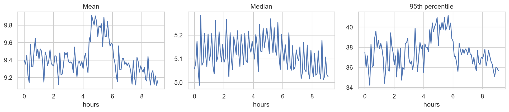
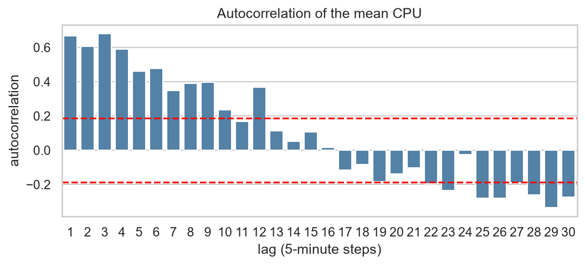
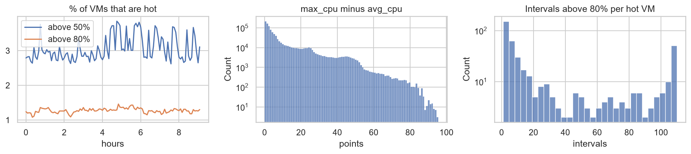
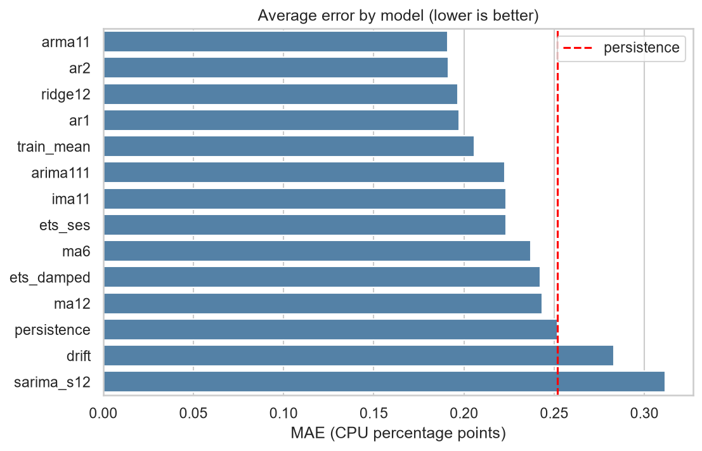
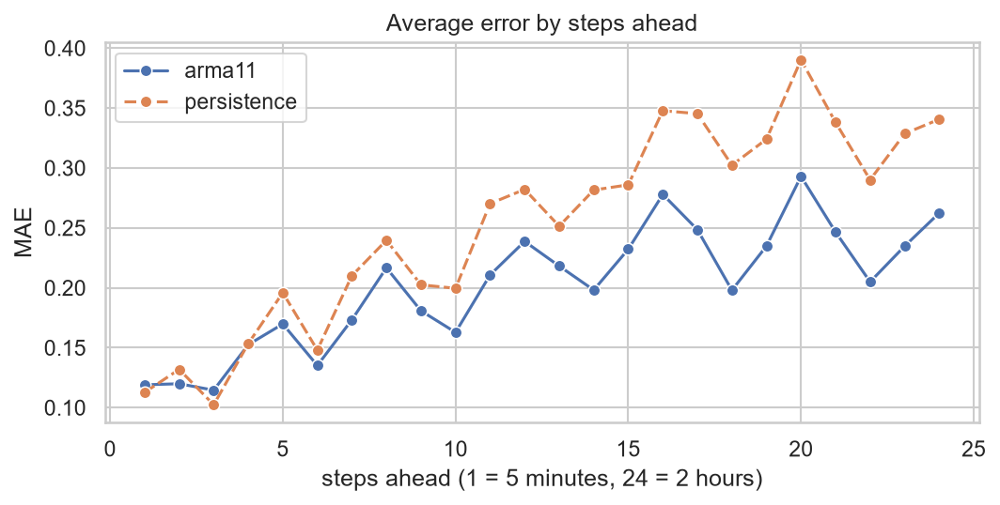
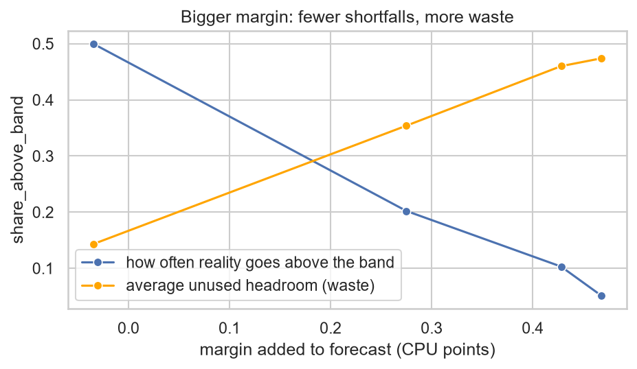
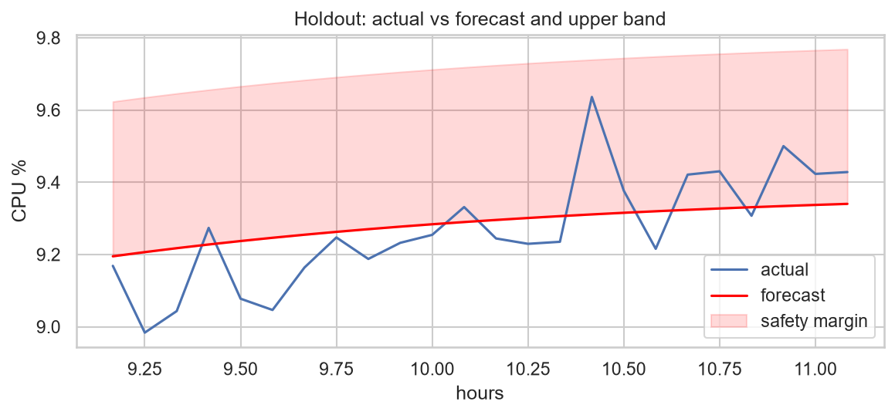

# Cloud Workload Forecasting and Capacity Planning

**Dataset:** Azure Public Dataset V2, curated `data-v1` release (10,000 VMs, 134 five-minute readings each)
**Task:** forecast `active_vm_count` and `aggregate_cpu_utilization` for the final 2 hours (24 steps), and recommend a capacity policy.

---

## 1. Executive summary

**How predictable is this workload?** Very, at the fleet level. The VM count never changes in this release, and the average CPU is a smooth, mean-reverting series around 9.4%. The best model's average validation error is 0.19 CPU points (about 2% of the level), and it grows only to about 0.26 points (under 3%) at two hours ahead.

**How much does a model help?** A little, in absolute terms. ARMA(1,1) is about 24% better than persistence in rolling-origin validation (MAE 0.191 vs 0.252). On the 2-hour holdout, scored once after the model and margin were fixed, it was about 32% better (MAE 0.099 vs 0.147). The top four models are within 0.01 MAE of each other, and the plain training mean is only about 8% worse than the best, so the series is close to a flat level plus noise.

**What should an infrastructure team do?** Do not plan on the bare forecast, and do not rely on the average alone. The average hides a small group of always-hot VMs and short spikes (`max_cpu` is about twice `avg_cpu`). I recommend three rules: provision for the forecast plus a 90% safety margin (about 4.6% above the forecast), alert on the share of VMs above 80% CPU, and handle the roughly 1% persistently hot VMs one by one (Section 6).

**Main limitations:** only about 9 hours of training data, a VM count that is constant by construction, and a margin estimated from a few overlapping windows.

## 2. Data and targets

**Audit.** The CPU file has 1,340,000 rows. The timestamps form a perfect 300-second grid, with no gaps, duplicates or missing values, and every VM has all 134 readings. No resampling or imputation was needed.

**Targets.** For each timestamp, `active_vm_count` is the number of distinct VMs with a valid reading, and `aggregate_cpu_utilization` is the unweighted mean of `avg_cpu` across those VMs, clipped to [0, 100]. Rows with missing `avg_cpu` are dropped and not filled. Both series were built from the full data first and then split: the first 110 timestamps are the training window (about 9.1 hours) and the last 24 are the holdout.

**No churn.** All 10,000 VMs were created at time 0 and deleted after the last reading, so the count is exactly 10,000 at every timestamp. The release only keeps VMs alive for the whole window, which is a selection effect and not a property of real fleets.

## 3. Workload analysis (training window only)



*Figure 1. Mean, median and 95th percentile of VM `avg_cpu` over the training window.*

**The aggregate is smooth.** The mean stays between about 9.1% and 9.9%, a band under 1 point. The typical 5-minute change is about 0.16 points. Averaging 10,000 VMs cancels most individual noise, so the mean is easy to forecast but a weak operational signal.



*Figure 2. Autocorrelation of the mean CPU.*

**Mean reversion, no trend, no visible cycle.** Autocorrelation is about 0.68 at lag 1 and fades slowly (0.53 at lag 6, 0.44 at lag 12), and the first and second halves have similar averages. This points to models that pull back toward a level, and it explains why persistence copies noise. A daily cycle needs 24 hours and the data covers about 11, so I could not test one. A seasonal model (period 12) was included as an experiment and was the worst.

**Load is broad, not concentrated.** The mean (9.4%) is far above the median (5.1%), so the distribution is right-skewed, but the busiest 1% of VMs use only about 10% of total CPU. My first guess, that a few hot VMs drive the mean, was wrong.

**One sustained peak.** The highest 10% of timestamps form a single episode between about hour 4.5 and hour 5.7. The gap between peak and low periods is 0.69 points (about 7% of the level). About 58% of VMs run higher in the peak, but the 100 biggest movers (1% of VMs) account for about 30% of the net change: a broad modest rise plus a small group of heavy movers.



*Figure 3. Share of VMs above 50% and 80% CPU, the gap between `max_cpu` and `avg_cpu`, and how long hot VMs stay above 80%.*

**The real risk is in the tail.** On average 3.1% of VMs are above 50% CPU and 1.3% are above 80%. In total, 437 VMs crossed 80% at least once, and 113 (1.13% of the fleet) stayed above 80% in more than half the intervals, so the hot group is mostly persistent with a smaller rotating part. Mean `max_cpu` is 18.4% against 9.4% for `avg_cpu`, so five-minute averages hide short spikes.

**Segments.** Interactive VMs average about 11.5%, Unknown about 10.4% and Delay-insensitive about 8.3%. Segment labels are fixed and known in advance, so they are safe to use, but I did not find a gain from segment-level forecasts and did not pursue them. The `>24` core and `>64` GB buckets hold 10 VMs each and are not interpreted.

## 4. Forecasting approach and validation

**Candidates.** Baselines (persistence, 6- and 12-step moving averages, training mean, drift), statistical models (AR(1), AR(2), ARMA(1,1), ARIMA(1,1,1), IMA(1,1), simple and damped exponential smoothing, seasonal ARIMA) and a direct multi-horizon ridge regression on 12 lags plus a rolling mean. I did not use neural networks: 110 points cannot support them and the series has little structure to learn.

**Validation.** Rolling-origin (expanding window): at each origin the model sees only earlier observations and forecasts the next 24 steps. There are 7 origins (36 to 84 training points, spaced 8 apart). Scores are averaged over origins. Shuffling is never used. The selection rule was fixed in advance: lowest mean MAE, ties go to persistence. A safe wrapper falls back to a constant forecast if a fit fails; no fallback occurred.

**Features.** The models use only past values of the target series. Fixed segment labels were available but not used.

**Metrics.** MAE (selection metric), RMSE and MASE. MASE is scaled by the one-step naive error, so values above 1 are expected for 24-step forecasts and do not mean the model is worse than naive; use it only to compare models. It is undefined for a constant series.

## 5. Results versus baseline



*Figure 4. Average validation MAE by model (lower is better). The red line is persistence.*

| Model | MAE | RMSE | MASE |
|---|---:|---:|---:|
| ARMA(1,1) | 0.1908 | 0.2322 | 1.5214 |
| AR(2) | 0.1912 | 0.2314 | 1.5258 |
| Ridge, 12 lags | 0.1967 | 0.2378 | 1.5706 |
| AR(1) | 0.1974 | 0.2370 | 1.5758 |
| Training mean | 0.2059 | 0.2455 | 1.6438 |
| ARIMA(1,1,1) | 0.2227 | 0.2665 | 1.7762 |
| IMA(1,1) | 0.2232 | 0.2669 | 1.7799 |
| Simple exp. smoothing | 0.2232 | 0.2670 | 1.7800 |
| Moving average, 6 | 0.2369 | 0.2820 | 1.8890 |
| Damped exp. smoothing | 0.2425 | 0.2877 | 1.9341 |
| Moving average, 12 | 0.2432 | 0.2846 | 1.9396 |
| Persistence | 0.2516 | 0.2885 | 2.0042 |
| Drift | 0.2829 | 0.3212 | 2.2537 |
| Seasonal ARIMA (12) | 0.3114 | 0.3577 | 2.4940 |

**ARMA(1,1) is selected** by the rule. It is 24.2% better than persistence on MAE. AR(2) (24.0%), ridge (21.8%) and AR(1) (21.5%) are essentially tied with it, and AR(2) has the slightly lower RMSE. I do not claim ARMA(1,1) is truly better than these. Drift (12% worse than persistence) and the seasonal model (24% worse) are the worst, because extrapolating a trend or a cycle adds noise to a flat, mean-reverting series.

**Stability.** Over the 7 origins ARMA(1,1) had the lowest error at 3, persistence at 2, and the training mean and AR(1) at 1 each. No model wins everywhere, and the origins overlap, so they are not independent tests.

**Active VM count.** Every model has zero error because the count is constant, and MASE is undefined. Persistence is selected by the tie rule. This says nothing about forecasting a fleet whose size changes.

## 6. Error and failure analysis



*Figure 5. Average error by steps ahead (1 = 5 minutes, 24 = 2 hours).*

**Error grows with the horizon.** For ARMA(1,1) it roughly doubles, from about 0.12 at 5 minutes to about 0.26 at 2 hours. In the first three steps persistence is as good as ARMA(1,1) (0.113 vs 0.119 at step 1), because the series barely moves over a few minutes. From about step 4 the mean-reverting model is better, by about 15% at step 12 (0.239 vs 0.282) and about 23% at step 24 (0.262 vs 0.341). The benefit is at the 1 to 2 hour planning horizon, which is the horizon of this task.

**What the model cannot do.** The forecast is a smooth curve from the recent level toward the long-run average. It cannot predict the random 5-minute noise or the timing of a peak, and it has no information about future spikes. The sustained peak in Section 3 is the clearest case: a model that only pulls toward the average will under-forecast it, which is why the safety margin matters. The absolute gains are small (a few hundredths of a CPU point), and an operator should not over-read them.

**Peak-period error was not measured separately.** I did not compute a dedicated error for peak timestamps. The margin analysis below measures how often the real value goes above the band, which is the quantity that matters for peaks.

## 7. Capacity recommendation



*Figure 6. A larger margin means fewer shortfalls but more unused headroom.*

**Trade-off.** Under-provisioning means throttled VMs, slow service and possible SLA breaches. Over-provisioning means paying for idle capacity. I measured the margin from rolling-origin forecast errors (training data only), as the share of past errors it covers:

- **80% band:** margin 0.28 points (2.9% of the level). Reality goes above the band about 20% of the time. Average unused headroom is 0.35 points.
- **90% band (chosen):** margin 0.43 points (4.5% of the level). Reality goes above the band about 10% of the time, by only about 0.05 points when it does. Unused headroom is 0.46 points.
- **95% band:** margin 0.47 points (5.0%). It halves the shortfall rate again for only 0.04 points more margin, so a team that fears outages more than cost could choose it.

I chose the 90% band before looking at the holdout. The errors come from 13 overlapping windows, so the top 5% is only a handful of values and the 95% figure is a rough estimate.

**Recommended policy.**

1. **Fleet headroom.** Every 5 minutes, forecast the next 2 hours and keep capacity for the forecast plus the 90% margin. For the final forecast this is 9.34% plus 0.43 points, an upper band of 9.77%, about 4.6% above the forecast. The margin is in CPU points of the fleet average, not cores or servers, because the data has no capacity figures.
2. **Spike alert.** Track the share of VMs above 80% CPU. It normally sits near 1.27%. Alert above 1.43% (higher than 99% of training timestamps), and add capacity or investigate even when the average looks calm. This threshold is narrow and was set from only 110 points, so treat it as a starting value to tune. The share above 80% stayed flat during the peak, while the share above 50% rose from about 3% to 3.8%, so tracking the share above 50% as well would catch that kind of event.
3. **Persistently hot VMs.** About 113 VMs (1.13% of the fleet) are above 80% in most intervals. A fleet-wide margin cannot fix them. Resize them, move them or give them dedicated capacity.

## 8. Final holdout check



*Figure 7. Holdout actuals, forecast and upper band.*

After the model (ARMA(1,1)) and margin (90%) were fixed, I scored the final 24 timestamps once and changed nothing afterwards. The model's MAE was 0.099 and RMSE 0.123, against 0.147 and 0.185 for persistence, about 32% better on MAE. None of the 24 real values went above the upper band (the highest was about 9.64% against a band of about 9.74%), and the average unused headroom was 0.44 points.

This is one window of 24 strongly linked points, so it is a noisy test. The holdout error is also about half the average validation error (0.19), so this window was easier than average, which partly explains why 32% is higher than the 24% from validation. The rolling-origin result is the stronger evidence. With a 90% band, 0 of 24 misses is consistent with the design but also suggests the margin was generous for this window.

## 9. Leakage controls and disclosure

- The targets were built from the full series first, then split. Holdout values were never passed to a model, a feature, a validation fold or the selection rule.
- Each rolling-origin fit uses only observations before its origin. No random splits were used.
- **Metadata columns not used:** `avg_cpu`, `max_cpu` and `p95_max_cpu` (computed over the whole VM lifetime, which includes the holdout) and `timestamp_vm_deleted` (reveals the future). `timestamp_vm_created` is always 0. They were used at most to describe the data.
- **Disclosure.** Early exploration printed descriptive statistics of the full series, including the holdout period, and printed the holdout mean once. These were never used to choose a model, a feature or a margin. Selection used only rolling-origin validation on the first 110 timestamps with a rule fixed in advance, and the holdout was scored once at the end.

## 10. Limitations and future work

**Limitations.**
- About 9 hours of training data (11 in total), so daily or weekly patterns cannot be modelled.
- The VM count is constant by construction, so this release does not test churn.
- The top models are tied, so the final choice is weak evidence for any one of them.
- The margin and the spike alert come from a few overlapping windows and one 110-point history.
- The aggregate is an unweighted mean of `avg_cpu`. It is not total compute demand or a core-weighted utilization.
- The holdout is a single short window.

**With more time.** Use a longer history for daily and weekly patterns. Forecast per VM category and add up the results, and test whether it helps. Produce proper prediction intervals. Forecast the share of hot VMs directly. Add a peak-specific error metric.

## 11. Reproducibility

```bash
python -m pip install -e ".[dev]"
python -m pytest -q
python -m forecasting.predict --data challenge_data --output predictions.csv
```

The command selects a model per target by validation, writes 24 rows with the columns `timestamp,active_vm_count,aggregate_cpu_utilization`, and takes the timestamps from the data. The EDA and model-comparison notebooks are in `notebooks/` and write their figures to `reports/figures/`.

## Appendix: Additional Figures

`03_vm_count.png` (VM count), `06_distribution.png` (CPU distribution), `07_peaks.png` (peaks), `09_category.png` (categories), `11_error_by_origin.png` (error by origin), `13_forecast.png` (forecast).

**Score definitions.** MAE is the average of |actual - forecast|. RMSE is the square root of the average of (actual - forecast) squared. MASE is MAE divided by the average absolute one-step change of the training series.

**Data source.** Microsoft, Azure Public Dataset V2: https://github.com/Azure/AzurePublicDataset. The curated `data-v1` release was supplied with the challenge.